# FA Remastered

*An open-source 64-bit engine for Supreme Commander: Forged Alliance. Bring your own game files.*

FA Remastered is a new engine for **Supreme Commander: Forged Alliance** that runs the game's own
data, scripts and mods. You need your own copy of the game; no game files are included here. The
engine follows the game as Forged Alliance Forever (FAF) runs it today, with FAF's game scripts, and
the tested set-up is a Steam copy of the game with FAF installed. A Steam-only installation has not
been tried. (The programs are still called `moho64...`, the project's working name.)

## About this project

FA Remastered is a for-fun, personal project, made for three reasons. First, I love Supreme
Commander. I play locally, not multiplayer, and I wanted to experience a "remastered" SupCom, so I
built one myself. Second, it is a learning experience: I wanted to see what I could do with AI.
Third, I wanted to mess around with the models in Blender and see my own idea of how these units
would look in a remaster; that part is just fun.

I decided to share it, so anyone can take anything from it and do whatever they like with it. Many
of the choices here are personal, and some won't suit everyone; that's fine. For multiplayer and the
community's own direction, the established community projects are the place to go. This one is
mainly for me, shared in case it's useful or fun for someone else.

## Goals

1. **Faithful in behaviour.** The real game files, Lua, mods and AI run unchanged, and units move,
   fight and path like the original. The measure is the original itself: the same replay is played
   in both engines and compared beat by beat.
2. **Modern internals.** 64-bit (no 4 GB address-space crashes), a renderer for today's graphics
   cards, and a simulation that can use more than one core.
3. **The same game, sharper, and your choice.** The original's artwork, icons, interface and sounds.
   Every new look is an option: you can switch between old and new, and pick and choose what you want.

Local play (a skirmish against AI) comes first. Multiplayer comes after it (see below).

## Where it stands (October 2026)

All thirteen test replays play out **identically to the original, to their last beat**: every unit
on every beat, every army's economy, and every random draw in the same order. The last of them, a
five-minute skirmish against seven M28 AIs with mods, got there on 16 October 2026. Since then the check has
moved on to three high-level multiplayer games from FAF's replay vault. Two of them are identical to the original
to their last beat since 19 October 2026, an 18-minute 2v2 on Funeral Plains and a 20-minute 1v1 on Abhor, and
the 31-minute 4v4 on Seton's Clutch is on its way.

A skirmish can be started from the game's own main menu and lobby. It runs in the new simulation, is
drawn by the new renderer inside the game's own interface, and can be played: select, order, build,
with the game's sounds, and replays are recorded and played back. It is not a finished game yet:
there is no saving and no multiplayer, and the campaign is in work (the Forged Alliance
operations and the tutorial start from the main menu and reach their first objectives; they are
not checked against the original yet). The stock AI opponents build and fight
in a first version that is not yet checked against the original; mod AIs such as M28 play.

The work runs in three tracks that share this repository, plus one outside it:

| Track | Folder | Program | State |
|---|---|---|---|
| Simulation | `src/` | `moho64` | Plays whole AI games headless; 13 of 13 replays identical to the original to the last beat |
| Renderer | `render/` | `moho64view` | Direct3D 12 and Vulkan; ground, water, units, effects, shadows; day and night, weather, lamps on units |
| Interface | `ui/` | `moho64ui` | The game's own interface scripts run: menu, lobby, in-game panels, orders, sound, replays; 494 of the original's 531 interface engine functions built |
| Remastered art | not in this repository | – | Remade unit models and a remade Seton's Clutch, made separately |

## What is new, and how to switch it

Every new look is a choice, and the original's way is always one of the choices. New looks that
change the whole game are **game options in the lobby**, chosen with the game's other options; looks
that are a matter of taste or of the graphics card are **each player's options** in the game's
Options menu (Video tab). None of them changes the simulation: they are only seen.

**In the lobby (game options):**

| Option | What it does | Choices (the original's way in bold) |
|---|---|---|
| Time of Day | A real sky with sun and moon instead of the map's fixed light: the light follows the hour, nights have stars and a moon | **Map's Own Light** (default), Dawn, Morning, Noon, Afternoon, Dusk, Night, Random |
| Length of Day | How long a whole day and night take in game time | Time Stands Still, 5 to 120 minutes |
| Weather | Clouds and their shadows, rain, storms with lightning, fog, snow. It follows from the game's seed, so every player and every replay sees the same weather | Changing (temperate, cold or dry), or one kind for the whole game: None, Clear, Cloudy, Overcast, Rain, Storm, Fog, Snow. With **Map's Own Light** there is no weather |
| Map Edge | What lies round the map, where no unit can go | No Machinery (default: land and sea go on past the edge, greyed out), **Machinery** (the original's frame) |

Rain wets the ground (darker and shinier, with puddles that mirror the sky, and rings where drops
fall); snow settles in patches, then covers the land, steep slopes last, and melts back into wet
ground. Rain and snow are one choice, so they cannot be had together.

**Options menu, Video tab (each player's own):**

| Option | What it does | Choices (the original's way in bold) |
|---|---|---|
| Look | The new renderer's lighting, sky, water, ground shading, unit shading, glow and building look, or the original's | Remastered (default), **Original** |
| Remastered Effects | Remade effects where the remastered art has them, and extras such as light from flashes and explosions | On (default), **Original** |
| Effects Quality | How many particles every effect throws | Full (default), Three Quarters, Half |
| Shell Tracers | Shells whose trail is a plain white line are drawn as hot tracers: white at the shell, through yellow and orange to dull red | On (default), **Original** |
| Rich Ground on Remastered Maps | Extra ground detail (creases, roughness, layers that blend by height) on maps made for it | On (default), Off |
| Tracks in Snow | Units tread prints into lying snow along the game's own track and footprint marks | On (default), Off |
| Upscaling (FSR 1) | AMD FidelityFX Super Resolution 1, for slower graphics cards | Off (default), Ultra Quality, Quality, Balanced, Performance |
| Frame Rate | Held to the screen, or capped, or free | Vertical Sync (default), Uncapped, 60, 120, 144 |
| Graphics API | Vulkan needs `dxcompiler.dll` beside the program (see Licences); takes effect from the next map | Direct3D 12 (default), Vulkan |

The game's own graphics settings in the same tab (Fidelity, Shadow Fidelity, Texture Detail,
Anti-Aliasing, Level Of Detail, and the presets) drive the new renderer and mean what they say.

**At night** the battle lights itself: shots in flight and weapons' beams light the ground and the
units around them (they do by day too, where it shows less), and hot tracers stand out against the
dark. Remastered units carry lamps (headlights, floodlights, beacons, windows) that come on from dusk
to dawn, throw light on the ground, and show as faint beams in rain, snow and fog; with Shadow
Fidelity on High their beams cast shadows. Units that are not remastered have no lamps.

**Remastered units** are loaded with `--remasters <folder>`; without it every unit is the game's own
model. **Seton's Clutch Remastered** is a separate map: given with `--maps <folder>`, it appears in the
lobby's map list beside the original Seton's Clutch, so the original map is always there to pick.

The main menu shows a slow flight over Seton's Clutch in the evening light where the original plays
its film.

## Remastered models: what to expect

The remastered units try to stay faithful to the original designs. They are also practice at
modelling for me and Claude, the AI this project is built with, so please don't expect anything
revolutionary. So far the UEF faction's units and buildings are done, and first, rough versions of
some commanders. The models, the remade effects and the remade Seton's Clutch are not in this
repository and are not released yet. An early look at them is below.

## A first look

> **EARLY LOOK.** The remastered UEF units in these pictures are an early prototype: they are still being tested and changed, and everything you see may change before it is finished. The original (legacy) units, textures and look still work and can be used as they are - they just don't get the new looks and effects.

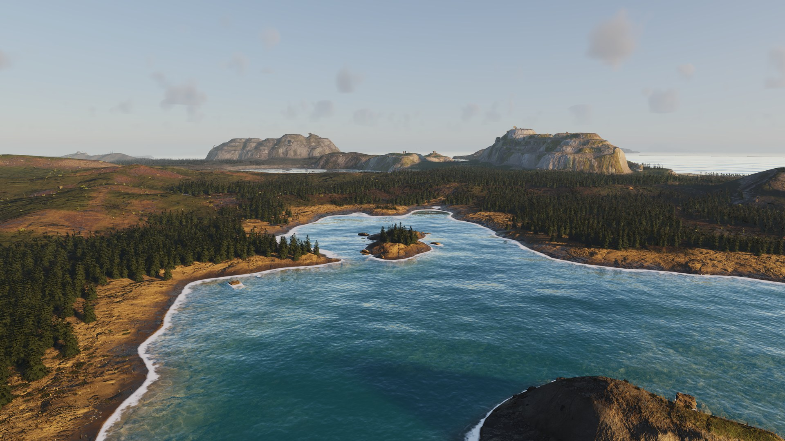
*Seton's Clutch Remastered, late afternoon*

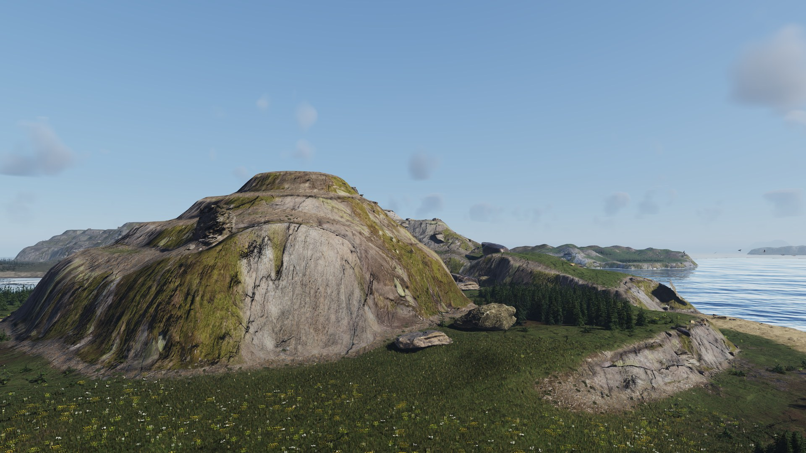
*The rock hill*

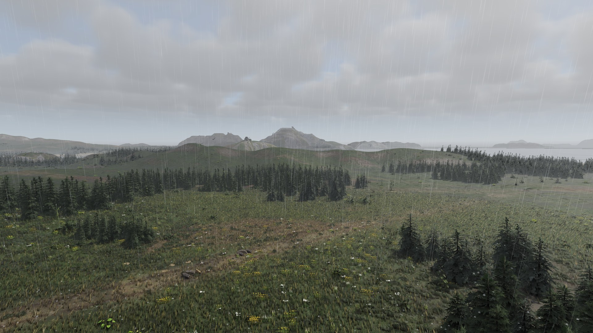
*Rain over the meadows*

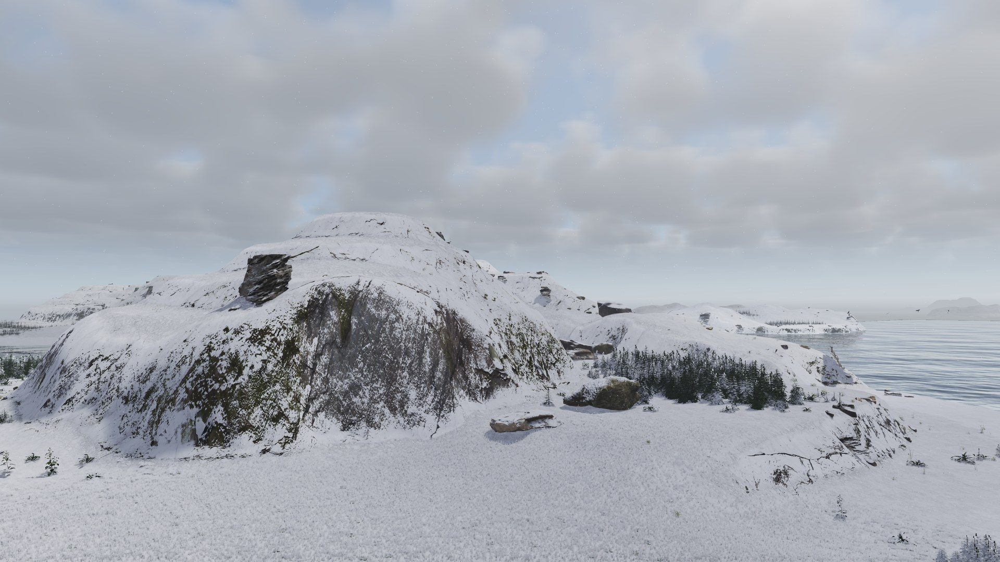
*Snow*

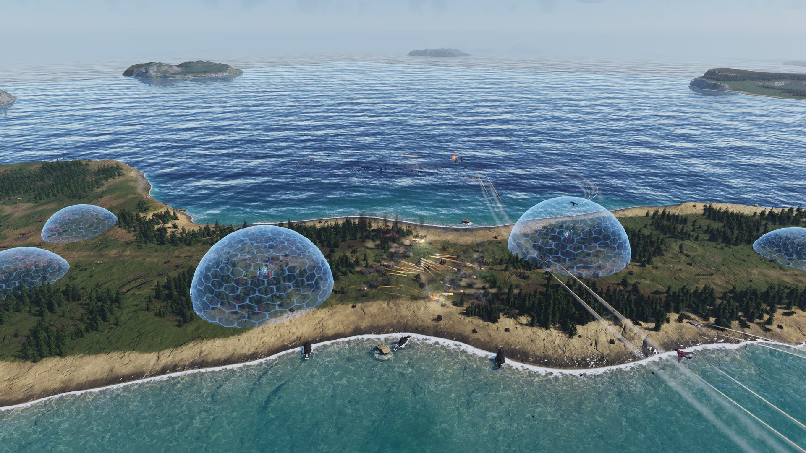
*UEF vs UEF on the land bridge*

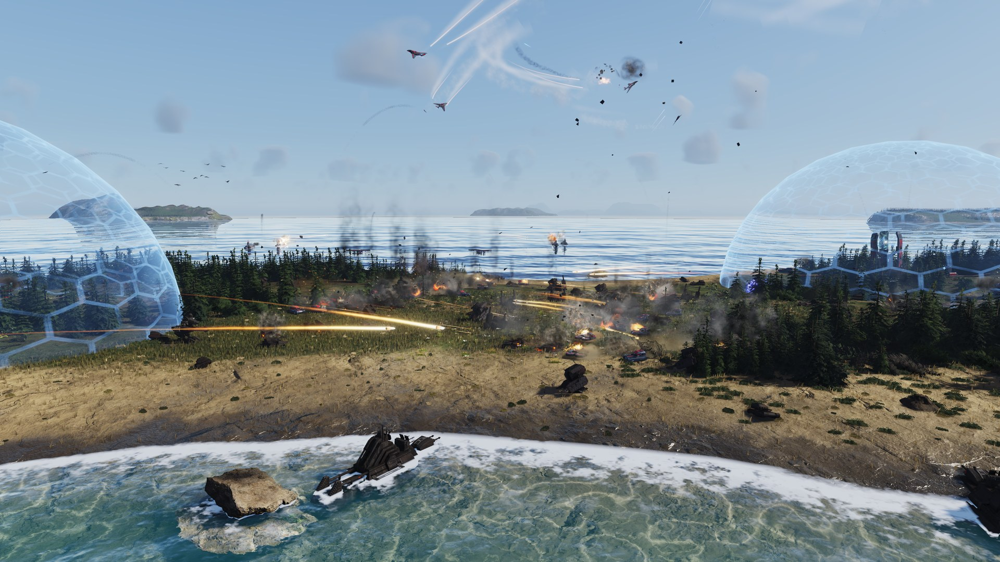
*The beach, Riptides and Wasps*

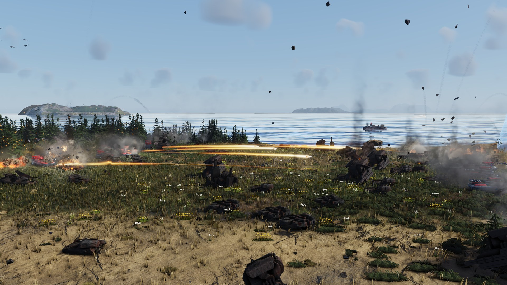
*The clash on the bridge*

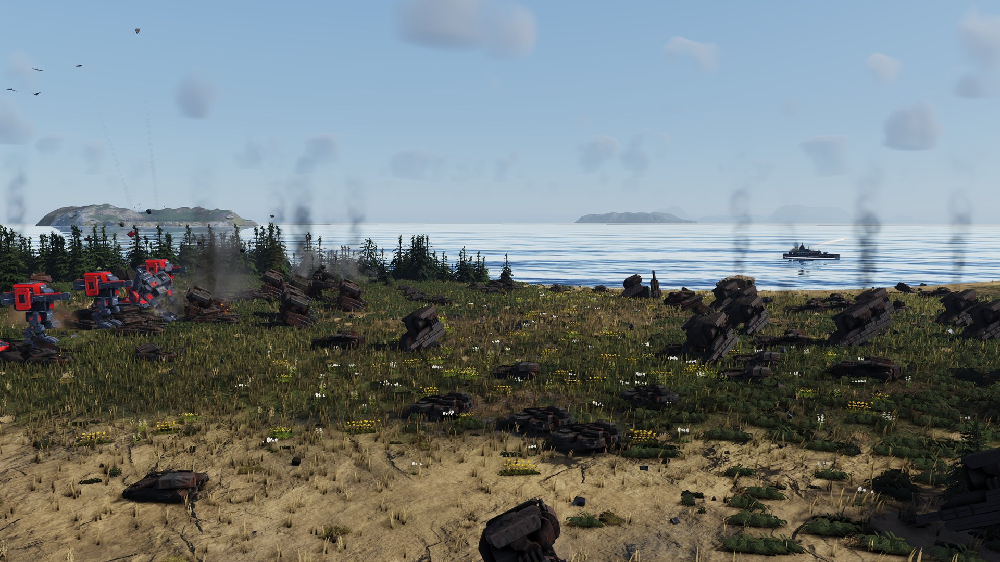
*Titans and Percivals*

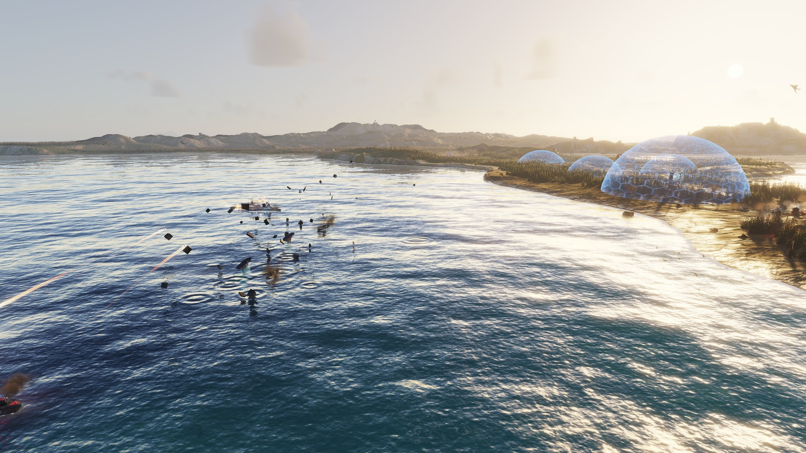
*Ships at dusk*

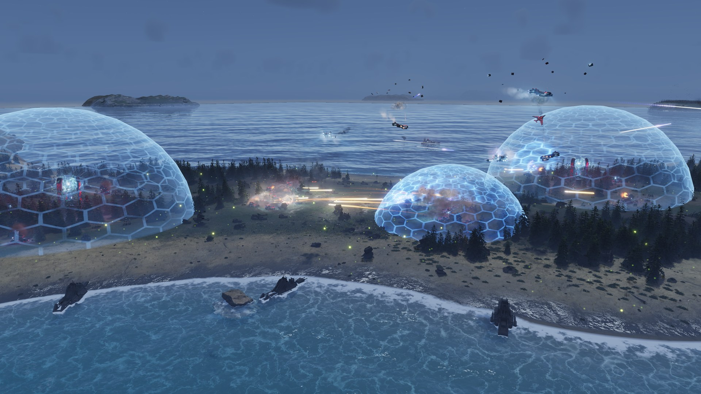
*Night: shields over the bridge*

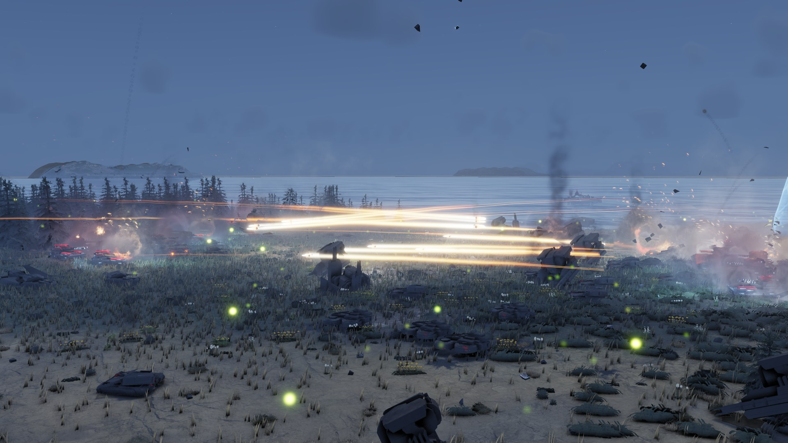
*Night fighting*

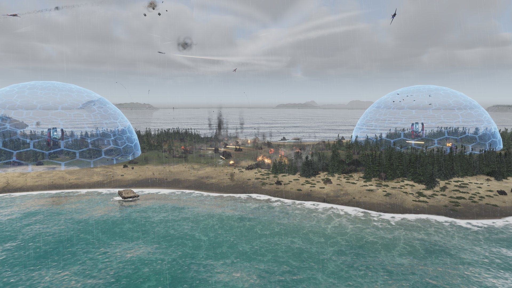
*A storm over the battle*

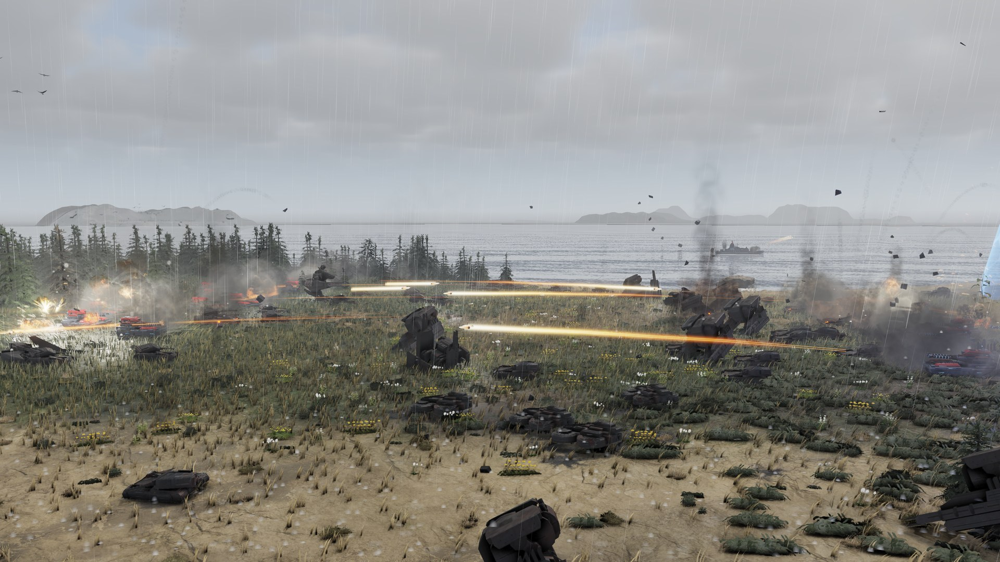
*Fighting in the rain*

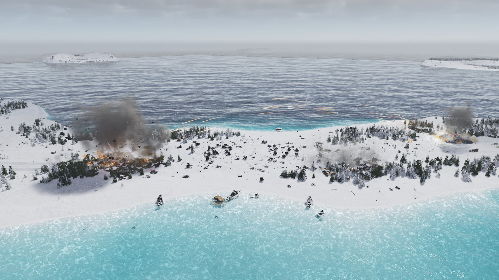
*Winter: the end of the Fatboys*

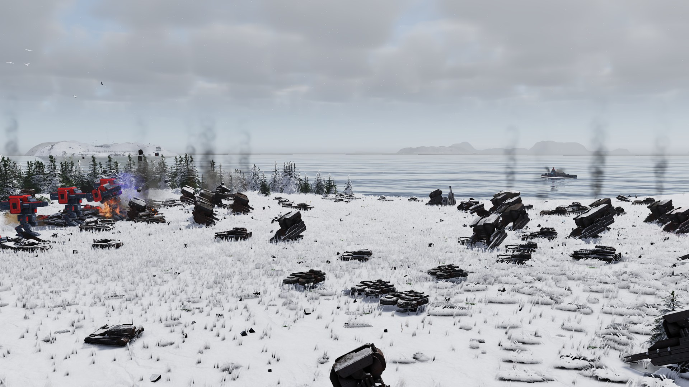
*Titans in the snow*

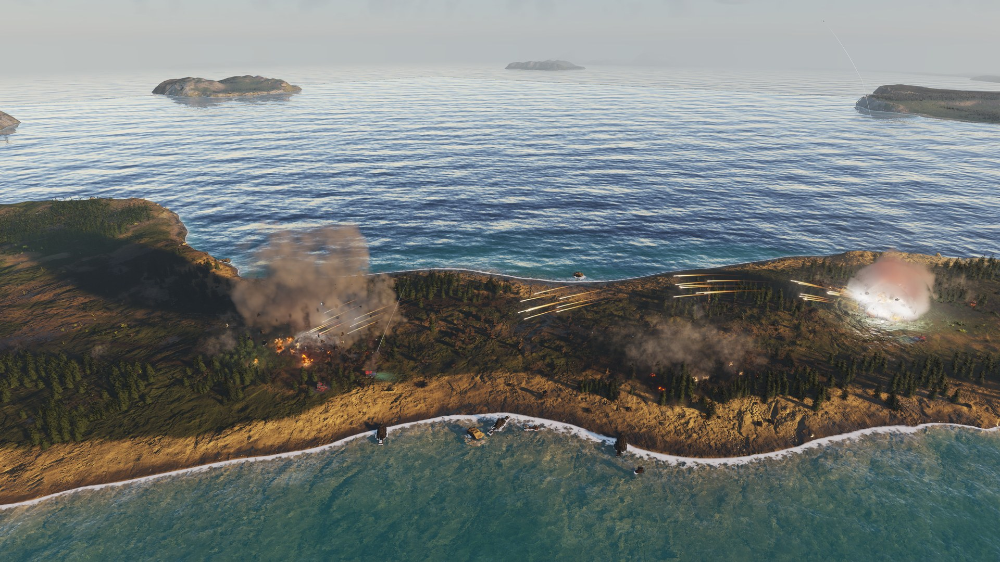
*Dusk: a Fatboy goes down*

## Simulation (`src/`)

What is built, each part rebuilt from how the original behaves:

- **Start-up:** the game's archives and mods mounted in the original's order; the game's Lua
  dialect ([docs/lua-dialect.md](docs/lua-dialect.md)); blueprint loading that matches the
  original's log line for line; the simulation's start-up order, armies, AI brains, map props.
- **Movement:** the original's spline steering for land and naval units, the hierarchical
  path search (8- and 32-cell clusters, a work budget per army and beat), the land navigator,
  formations, and units getting out of each other's way (prediction, right of way, side-steps,
  pushes).
- **Aircraft:** the rigid-body flight model with the original's force and torque controllers, the
  air navigator, attack runs and circling, landing, fuel, air staging, carriers, falling wrecks.
- **Transports and ferries:** seats from the model's bones, loading and unloading, ferry routes
  with their beacons, factories that ferry.
- **Economy and building:** the share-out of mass and energy, storage, adjacency, engineers,
  factories and their rally orders, upgrades, repair, assist, reclaim, capture, silos, placement
  rules.
- **Combat:** target choice by the scripts' priorities, aim controllers and turret speeds, the fire
  clock, projectiles (ballistic, homing, bombs that lead a moving target), beams, area damage,
  shields, death.
- **Intel:** vision, radar, sonar, omni and their counters; recon blips, jamming.
- **The stock AI:** the AI brain's and platoons' engine functions the classic AIs call, their build
  functions and plans (first version, not yet checked against the original).
- **Orders and scripts:** command queues, the order of work inside a beat, script threads and their
  timing, the replay's command stream played back, a new game started from the lobby's
  configuration.
- **For the other tracks** (`src/sim/sim_view.h`): the world of every beat as plain data (units,
  bone poses, projectiles, effects, sounds), what an army sees, a unit's state for the panels,
  orders written the way a replay stores them.

The arithmetic is the simulation's own (sin, cos, atan2, and the original's single-precision
rounding where it matters), so results do not depend on the platform's maths library.

### How it is checked

Each replay is recorded twice, once played by the original game and once by this engine: every
unit's position, orientation, health, state and orders on every beat, every army's economy and every
random draw. A tool names the first beat where the two records differ, and what differs. All thirteen
replays are compared after every change to the simulation; a change that makes any of them differ is
not accepted as it is.

| Replay | Beats | Result |
|---|---|---|
| Experimental units, first set | 947 | **identical to the end** |
| Transports and ferries | 2,181 | **identical to the end** |
| Air battle | 1,176 | **identical to the end** |
| Upgrades | 9,014 | **identical to the end** |
| Missiles | 6,649 | **identical to the end** |
| Experimental units, second set | 2,246 | **identical to the end** |
| Submarines | 1,719 | **identical to the end** |
| Engineers | 3,439 | **identical to the end** |
| Eight-army AI game | 700 | **identical to the end** |
| Land battle | 2,019 | **identical to the end** |
| Economy | 6,263 | **identical to the end** |
| Naval battle | 972 | **identical to the end** |
| Skirmish against seven M28 AIs | 3,121 | **identical to the end** |

"Identical" means every unit on every beat, every army's economy, and all random draws in the same
order. More replays follow, among them real multiplayer games.

Where the original's own behaviour is broken and fixing it does no harm, the engine may fix it in
new games, never while a replay plays. Every such case is listed in
[docs/deviations.md](docs/deviations.md).

## Renderer (`render/`)

A renderer behind a small device interface, with a Direct3D 12 and a Vulkan backend, fed by the
simulation through plain data. Details, measurements and known gaps: [render/README.md](render/README.md).

- **The world:** ground from the map file with its layers, normal map and decals, flattened where
  buildings flatten it; water that is seen through and mirrors the sky and what stands near it, with
  foam on the shores and wakes behind ships; the map's trees and rocks, swaying in the wind; units and
  projectiles as their models with team colours, posed by the simulation's bones (turrets aim, legs
  walk); levels of detail chosen by size on screen.
- **Effects:** the game's own emitters, beams and trails played from their blueprints, as the
  scripts create them; scorch marks and markers laid on the ground; shields; light from explosions,
  shots and beams; glow round what is brighter than the screen can show.
- **Day, night and weather:** a computed sky, sun and moon, stars, drifting clouds and their shadows,
  rain, snow, fog, storms with lightning; lamps on remastered units after dusk.
- **For play:** strategic icons, the minimap, only what the player's army sees (units, radar
  blips, the unseen ground darkened), what is under the mouse, life bars, range rings.
- **Two looks:** the original's light formulas for each faction are kept beside the modern ones
  (the Look option above).
- **In work, a lighting upgrade of the modern look:** light you can see in the air (fog, the sun's
  shafts, lamps' beams; a first version is in), then AMD's FSR 3 upscaler, reflections in screen
  space and softer shadows, volumetric clouds, and ray-traced reflections, bounce light and shadows
  on Direct3D 12 and Vulkan. Each piece is a player option, off by default, with today's look as the
  fallback. Order and state: [docs/render-lighting.md](docs/render-lighting.md).

## Interface (`ui/`)

The original's interface is written in Lua and drives a small set of engine-side controls. This
track builds that engine side, so the game's own interface scripts, and interface mods, run
unchanged. Details: [ui/README.md](ui/README.md); what is left and in which order:
[docs/ui-roadmap.md](docs/ui-roadmap.md).

- **The control toolkit:** frames, bitmaps, text, edit fields, lists, scrollbars, sliders, combo
  boxes; layout, depth, hit testing, focus, draggers, key maps, as the original does them. Text is
  measured and drawn the original's way. Four screens were compared with lossless screenshots of
  the original at 3840 x 2160: every part sits on the same pixel.
- **Front end:** main menu, options, the skirmish lobby (map, slots, AI opponents, game options),
  Launch, the replay dialog.
- **In game:** the game's own in-game interface on a running simulation: economy bar, score and
  clock, orders and construction panels, factory queues, build templates, the unit panel; selection
  by click, box and category keys; move, attack, patrol, build, assist, reclaim, repair by the
  original's right-click rule; building ghosts that show where a building can stand; the camera by
  the original's rules, camera shake; the minimap; pause and game speed; victory, defeat and the
  score screen; leaving and restarting a game.
- **Replays:** every game is recorded in the original's replay format and can be played back from
  the game's own Replay dialog.
- **Sound:** the game's own sound banks read and mixed: interface sounds, music, voices, and the
  world's sounds at their place, heard only where the player's army sees.

In work: the campaign (operations start from the main menu and reach their first objectives).
- **Movies:** the game's own films (.sfd) play in their screens, with their sound from the game's
  sound banks as the scripts start it.

Not yet: saved games, the console, joining a network game.

## Platforms

**Windows (x64)** is the platform in daily use, and the only one tested.

**Linux and macOS: support exists in parts, untested.** Nobody working on the project has a Linux
machine or a Mac, so read this as "may work, expect problems":

- The headless simulation (`moho64`) builds for Linux (x86-64) and for macOS on Apple Silicon
  (`py tools/build_zig.py --target x86_64-linux-gnu` or `--target aarch64-macos`; CMake or
  `./build.sh` on Linux itself). It ran on Linux early in the project with results identical to
  Windows; it has never run on macOS.
- The renderer's Vulkan backend has code for Linux (X11 and Wayland) and macOS (through MoltenVK).
  It compiles for both but has never run on either.
- The game itself (`moho64ui`) has its Linux and macOS parts written: the window, keys, mouse, sound
  and clipboard through SDL 3, the game's fonts through stb_truetype, and the world drawn by the
  renderer's Vulkan backend on the window. Cross-built from Windows it compiles for both; built on
  Linux or a Mac it links to the system's SDL 3 (`py ui/build_ui.py`). It has never run on either.
  Some of these parts were tried on Windows through the same code (the SDL input, the stb fonts),
  but a first run on each system is still to come. Details: [docs/ui-platforms.md](docs/ui-platforms.md).

## Multiplayer

Local play comes first: I play solo, so that is what this project is built for. Today the lobby is
local: no network game can be hosted or joined, and FA Remastered cannot connect to FAF's servers.

The plan, in order:
1. Replays of real multiplayer games join the checks, together with a harness that runs two copies of
   the simulation side by side on one PC, passing orders between them as networked players do, and
   compares a fingerprint of the whole game state on every beat.
2. Then the simulation is spread over several cores, guarded by both of those checks.
3. Then real play over the internet.

The engine is MIT licensed, and anyone who wants to build on it is welcome, for example to integrate
it with FAF.

## Build (Windows)

    py -m pip install ziglang        (once: the compiler, no Visual Studio or SDK needed)
    py tools/build_zig.py            -> build-zig/moho64.exe          the simulation, headless
    py render/build.py               -> build-render/moho64view.exe   viewer: replays, recordings, new games
    py ui/build_ui.py                -> build-ui/moho64ui.exe         the game with its interface

The simulation alone also builds with CMake (`cmake -B build -G Ninja && cmake --build build`) or
`./build.sh`. For the Vulkan backend, put `dxcompiler.dll` beside the program; see
[docs/render-vulkan.md](docs/render-vulkan.md).

## Testing

The [portable testing framework](docs/testing.md) runs the same Lua tests through Windows, SDL, or
headless compatibility adapters. Test code uses named keys, clicks, Unicode text, clipboard and
window operations. The shared runner isolates preferences and writes JSON and JUnit results:

UI cases run in `moho64ui_test`, which shares the game's application library and contains the test
adapters. CMake can build the software test host without SDL or world rendering; the existing UI build script
uses `--tests` for its windowed hosts.

```sh
cmake -S . -B build-native -DMOHO64_BUILD_UI=ON -DBUILD_TESTING=ON
cmake --build build-native --parallel 4
python3 tests/run.py --build-dir build-native --init path/to/init.lua
```

Framework self-tests run through `ctest --test-dir build-native --output-on-failure` without game data.

## Run

    moho64ui  --init <the game's init .lua> --window [--remasters <folder>] [--maps <folder>]
    moho64view --fa "<the game's folder>" --init <init .lua> --sim <replay.SCFAReplay>
    moho64    --init <init .lua> [--mods uids.txt] --sim <replay.SCFAReplay> --ticks 600 --log sim.log
    moho64    --init <init .lua> --session <game configuration> [--seed N] --ticks 6000 --log sim.log
    moho64    --init <init .lua> [--mods uids.txt] --rules --check-lua --log out.log

- The init file is the game's own, the Lua file that says which archives and folders to mount
  (with FAF installed, for example FAF's `init_faf.lua` in its `bin` folder).
- `moho64ui` opens the game's main menu; Skirmish leads through the lobby into a game. Its options
  are in [ui/README.md](ui/README.md).
- `moho64view` plays a replay (or a new game, `--session`) in the renderer with a free camera;
  its options are in [render/README.md](render/README.md).
- `moho64` runs the simulation without a picture: a replay, or a new game from the configuration
  a lobby hands over. `--rules` runs the blueprint loader, `--check-lua` compiles every script the
  game can see. `--twice` plays the same game a second time in the same process (a check that
  nothing of the first game is left behind).
- `moho64 --init <init .lua> /map X1CA_001 /diff 2 /faction 1 --ticks 6000` starts a campaign
  operation headless, the way the game's own launcher does (with the campaign's mods).
- On Linux, map the game's Windows paths with `--map "C:/Program Files (x86)/Steam/...=/host/dir"`.
- The engine's fixes to the game's broken scripts ([docs/deviations.md](docs/deviations.md)) are
  the files in `data/fixes/hook/`. They are found in `data/fixes` beside the program or one folder
  up (as when run from `build-zig/`), or where `MOHO64_FIXES_DIR` says; a release ships that folder
  beside the program. Without it the game's scripts run unfixed, and the log says so. They are on
  in new games and off while one of the original's replays plays; `MOHO64_FIXES=0` turns them off.

## Layout

- `src/core`: log, host files, archives, the virtual file system.
- `src/script`: Lua states, the functions every state has, script threads.
- `src/sim`: the simulation. [docs/architecture.md](docs/architecture.md) says where each part is.
- `src/app`: the command-line host `moho64`.
- `data/fixes/hook/`: the engine's fixes to the game's broken scripts, as hooks laid out like the
  game's own paths, joined only when the fixes are on.
- `render/`: the renderer and its viewer.
- `ui/`: the interface toolkit, sound, and the host `moho64ui`. `ui/data/hook/`: the lobby's and
  the Options menu's new choices, as hooks read after the game's own files (which stay untouched).
- `docs/`: the Lua dialect, the architecture, deliberate departures from the original, notes on
  performance, and the answers the tracks gave each other (`engine-answers.md`,
  `render-answers.md`), many of them accounts of how the original does something.
- `tools/`: build script, the recording comparison (`recdiff.py`, `regress.py`), generators.
- `tests/`: dialect tests and the portable framework. `ui/tests/`: existing interface tests.

## Licences

FA Remastered is MIT licensed (see `LICENSE`): use it, change it, build on it.

This is an independent reimplementation. It contains no code or data from the original game, and the
game's files are loaded from the player's own installation at run time.

Third-party code in this repository, each with its licence beside it:
- `third_party/lua/`: Lua 5.0 (MIT licence, Copyright (C) 1994-2003 Tecgraf, PUC-Rio), changed to the
  game's dialect.
- `third_party/zlib/`: zlib's inflate (zlib licence, (C) 1995-2022 Jean-loup Gailly and Mark Adler).
- `third_party/mimalloc/`: mimalloc (MIT, Microsoft Corporation).
- `render/third_party/fsr1/`: AMD FidelityFX Super Resolution 1 (MIT, Copyright (c) 2021 Advanced
  Micro Devices, Inc.), the upscaler offered as a player's option; `render/fsr1_source.cpp` is made
  from it.
- `render/third_party/fsr3/`: AMD FidelityFX Super Resolution 3.1.5's upscaler shaders (MIT, Copyright
  (C) 2026 Advanced Micro Devices, Inc.), ported onto the renderer's compute shaders.
- `render/third_party/vulkan/`: Khronos Vulkan-Headers 1.3.296, C headers only (Apache-2.0 OR MIT).
- `render/third_party/dxc/`: DirectX Shader Compiler headers `dxcapi.h`, `dxcerrors.h` (University of
  Illinois/NCSA).
- `ui/third_party/pl_mpeg/`: pl_mpeg by Dominic Szablewski (MIT), which decodes the game's movies.
- `ui/third_party/SDL3/`: SDL 3's public headers (zlib licence), for the Linux and Mac builds.
- `ui/third_party/stb/`: stb_truetype by Sean Barrett (public domain or MIT), which draws the game's
  fonts on Linux and Mac.

Not in the repository: `dxcompiler.dll`, Microsoft's DirectX Shader Compiler, used by the Vulkan
backend and to compile Direct3D 12 shaders faster at first start (University of Illinois/NCSA, the
LLVM licence; its licence files ship beside it).

**Forged Alliance Forever (FAF).** FA Remastered is not made by, affiliated with or endorsed by FAF.
FAF's community keeps Forged Alliance alive and maintains the game scripts most players use today;
FA Remastered runs those scripts from the player's own FAF installation and includes none of them
(FAF's game scripts, github.com/FAForever/fa, carry no licence). Where FAF's patches to the original
program (github.com/FAForever/FA-Binary-Patches, MIT) change how the game behaves, this engine behaves
the same way, in its own code, so that FAF's scripts and replays run as they do there.

**M28AI.** The engine is tested with the M28 AI by maudlin27 (github.com/maudlin27/M28AI), run as a
mod from the player's own mods folder. M28AI is licensed CC BY-NC-SA 4.0 (attribution, non-commercial,
share-alike). It is not bundled with FA Remastered, and no M28 code is in this repository.

Supreme Commander and Forged Alliance are trademarks of their owners.

## Credits

- Gas Powered Games, for Supreme Commander and Forged Alliance.
- The FAF community, for keeping the game alive and its scripts maintained for over a decade.
- maudlin27, for M28AI, the opponent most of the tests are played against.
- The authors of Lua, zlib, mimalloc, FidelityFX Super Resolution, the Vulkan headers, the
  DirectX Shader Compiler, pl_mpeg, SDL and stb.
